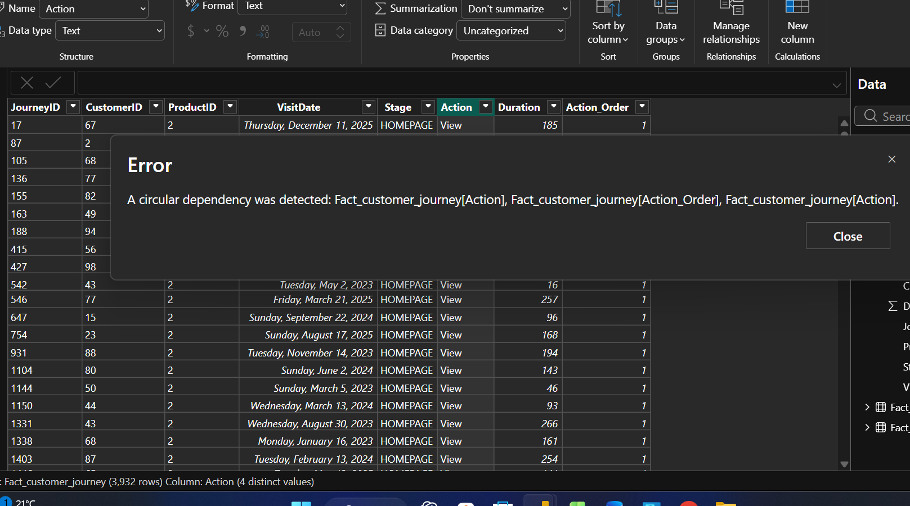

# 📊 Omni-Channel Marketing Analytics & Customer Journey Funnel

An end-to-end Marketing Analytics and Customer Journey project analyzing omni-channel campaign engagement, e-commerce conversion funnel velocity, and post-purchase customer sentiment across multi-touch acquisition channels.

---

## 1. Project Title & Overview

### Business Problem
Digital commercial teams frequently allocate significant marketing budgets across social media, video ads, blogs, and search without unified visibility into how those touchpoints drive downstream conversions and customer retention. Management faced three critical analytical bottlenecks:
1. **Siloed Campaign Attribution:** Engagement telemetry (views, clicks, CTR) was tracked across isolated channels, making it difficult to evaluate comparative channel efficiency and seasonal ROI.
2. **Funnel Friction & Checkout Duration:** While visitors engaged with top-of-funnel content, significant drop-offs occurred between product exploration and final purchase, with checkout sessions showing prolonged friction.
3. **Disconnected Post-Purchase Feedback:** Customer satisfaction and review scores were analyzed separately from transactional data, masking quality issues in specific product categories and European markets.

### Solution & Scope
To solve these challenges, an end-to-end analytical pipeline and business intelligence suite was engineered:
- **Data Engineering & Cleansing:** Built in **Microsoft SQL Server** using advanced T-SQL (CTEs, `ROW_NUMBER()` window functions for clickstream deduplication, duration imputation with `AVG() OVER()`, and string parsing).
- **Data Architecture:** Designed an enterprise **Star Schema** with dimension and fact separation (`Dim_customers`, `Dim_products`, `dCalendar` to `Fact_engagement_data`, `Fact_customer_journey`, `Fact_customer_reviews`).
- **Executive Reporting & UX:** Built in **Microsoft Power BI** featuring a 3-page interactive report with custom UX layouts, a dedicated `Key Measure` DAX repository, and fine-tuned visual interactions (`Edit Interactions`) to prevent redundant single-item visual filtering.

---

## 2. Tech Stack

| Technology | Role in Project |
| :--- | :--- |
| **Microsoft Power BI Desktop & Service** | Interactive reporting, multi-page executive layout, custom canvas templates, DAX measure modeling, and optimized visual interaction governance (`Edit Interactions`). |
| **Microsoft SQL Server / T-SQL** | Relational data architecture, data hygiene, CTE deduplication (`ROW_NUMBER()`), window function duration imputation (`AVG() OVER()`), and dimensional extraction queries. |
| **DAX (Data Analysis Expressions)** | Centralized measures (`Key Measure` table), Time Intelligence, conversion funnel ratios, channel CTR efficiency, and review sentiment metrics. |
| **Python** | Clickstream behavioral simulation and synthetic data generation. |

---

## 3. Dashboard Preview / Project Visuals

### Page 1: Campaign Engagement & Media Performance
Evaluates top-of-funnel reach, total engagements, click-through rates (CTR), seasonal peaks, and content channel effectiveness.
* **Key Metrics:** 46M Views, 3M Clicks, 6.46% CTR, 49M Total Engagements.
* **UX & Slicer Optimization:** Slicer interactions are selectively governed via **Edit Interactions** (e.g. filtering by `Content Channel` disables filtering on the `By Content Type` visual to maintain comparative channel benchmarks without reducing the chart to an uninformative single column).

---

### Page 2: Customer Journey & Conversion Funnel
Tracks user movement across stages (Homepage → Product Page → Checkout), highlighting stage durations, conversion elasticity by price category, and regional European performance.
* **Key Metrics:** 2K Unique Visitors (2.20K Homepage visits), 260 Total Conversions, 11.82% Conversion Rate, 92.08s Average Duration.
* **Funnel Stages:** Homepage (2.20K, 100%) → ProductPage (1.23K) → Checkout (0.26K, 11.8%). Checkout stage duration averages 222.5 seconds.

---

### Page 3: Customer Feedback & Product Sentiment Analysis
Analyzes 1,804 verified customer reviews, breakdown of ratings (1–5 stars), sentiment ratios, and highlights category and regional satisfaction gaps.
* **Key Metrics:** 1.8K Total Reviews (1,804), 3.98 / 5.0 Average Star Rating, 1.3K Positive Reviews (70.45%), 14.75% Neutral, 267 Negative Reviews (14.8%).
* **Risk Drivers:** Footwear category records the lowest rating (3.3 / 5.0), and Southern Europe records the lowest regional satisfaction (3.1 / 5.0).

---

### Data Model Architecture (Star Schema)
Enterprise-grade dimensional model with 1-to-many single-direction relationships between central dimensions (`Dim_customers`, `Dim_products`, `dCalendar`) and granular fact tables (`Fact_engagement_data`, `Fact_customer_journey`, `Fact_customer_reviews`), supported by a dedicated `Key Measure` table.

---

## 4. Key Insights

* **46M Views & 49M Engagements with Distinct Seasonal Peaks:**
  Across multi-channel marketing campaigns, the brand achieved **46.0M views** and **3.0M clicks** (**49.0M total engagements**), maintaining a solid **6.46% average CTR**. Video and Social Media generated the vast majority of clicks, whereas Blog content delivered the highest click efficiency (~8.8% CTR). Engagement surged in July (summer campaign peak) and November–December (holiday shopping surge), with **Medium price tier** products capturing the largest share of consumer interest (~1.5M views/clicks).

* **11.82% Overall Conversion with High-Ticket Efficiency (37.55%):**
  From 2.20K initial Homepage visitors, 1.23K advanced to product exploration, resulting in **260 completed conversions** (**11.82% conversion rate**). Among users reaching consideration, high-priced items achieved the strongest conversion rate (**37.55%**), followed by medium (**25.56%**) and low (**21.61%**). However, checkout sessions average **222.5 seconds**—more than double product page duration (89.1s)—highlighting significant checkout form and payment hesitation.

* **3.98 / 5.0 Average Rating Gated by Footwear and Regional Logistics Gaps:**
  Across 1,804 customer reviews, overall satisfaction remains positive at **70.45% (1.3K reviews)** with a **3.98 average star rating**. Nonetheless, **267 reviews (14.8%)** were negative (1–2 stars). Negative feedback concentrated heavily in **Footwear (3.3 / 5.0)** and **Southern Europe (3.1 / 5.0)**, where sizing discrepancies and post-purchase delivery lead times significantly depressed brand loyalty.

---

## 5. Business Recommendations

1. **Scale Ad Spend During July and Q4 Seasonal Surges:**
   - Double down on Video and Social Media campaigns during high-intent peaks (July summer promotions and Q4 holidays).
   - Leverage Blog content for high-intent SEO and technical product guides where CTR efficiency reaches 8.8%.

2. **Streamline the 222-Second Checkout Friction:**
   - Simplify the checkout flow by introducing express payment options (Apple Pay, Google Pay, PayPal) and one-click guest checkout to reduce the 222.5-second completion time.
   - Display localized shipping costs and estimated delivery dates upfront on the `ProductPage` to reduce last-step abandonment.

3. **Remediate Quality & Logistics in Footwear and Southern Europe:**
   - Revamp product sizing charts and description accuracy for Footwear (rated 3.3 / 5.0) to reduce customer expectation mismatches and return rates.
   - Audit Southern European logistics partners to shorten delivery lead times and lower the 14.8% negative sentiment rate.

---

## 6. Interactive Dashboard

Experience the live, interactive Power BI report with full cross-filtering, slicer interaction governance, and drill-through capabilities directly in your browser:

👉 **[Click Here to Open the Live Dashboard](https://app.powerbi.com/view?r=eyJrIjoiMDc2NDQ3M2YtOGI3NC00YTE3LTkzZDYtYjdmYjAxYzljMmFmIiwidCI6ImVhZjYyNGM4LWEwYzQtNDE5NS04N2QyLTQ0M2U1ZDc1MTZjZCIsImMiOjh9)**
