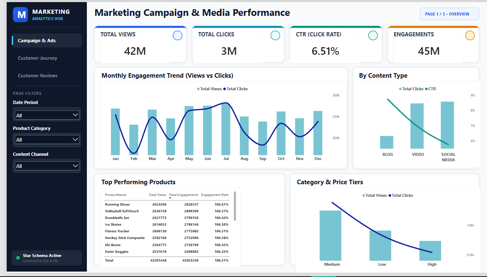
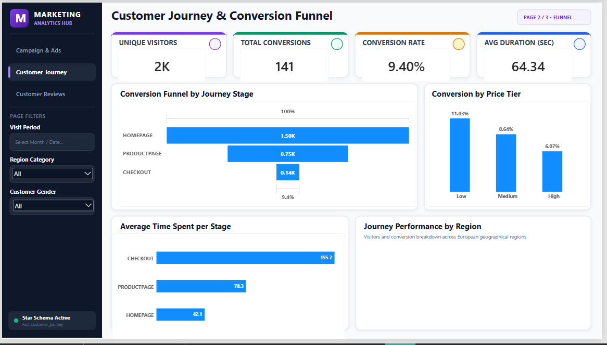
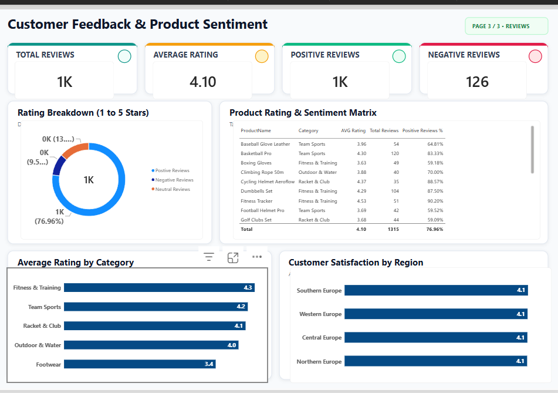

# 📊 Omni-Channel Marketing Analytics & Customer Journey Funnel

An end-to-end Marketing Analytics and Customer Intelligence project analyzing campaign performance, e-commerce conversion funnel friction, and post-purchase customer sentiment across multi-touch acquisition channels.

---

## 1. Project Title & Overview

### Business Problem
Digital retail brands frequently spend millions across paid search, video, social media, and newsletters without unified visibility into how those impressions translate into actual sales and customer satisfaction. Management faced three primary analytical challenges:
1. **Siloed Media Attribution:** Marketing metrics (views, clicks, CTR) were tracked separately by channel without a single source of truth for media ROI.
2. **Funnel Friction & Cart Abandonment:** Traffic successfully arrived at the website, but significant user drop-offs between product exploration and checkout masked underlying friction points across regional markets and price categories.
3. **Disconnected Customer Sentiment:** Post-purchase customer reviews and star ratings lived apart from customer journey data, making it difficult to pinpoint whether poor sentiment was driven by product expectations, price perception, or operational issues.

### Solution & Scope
This project designs and deploys an end-to-end data pipeline and business intelligence suite:
- **Data Engineering & Cleansing:** Built in **Microsoft SQL Server** using advanced T-SQL (CTEs, `ROW_NUMBER()` window functions for deduplication, duration imputation, and string parsing).
- **Data Architecture:** Implemented a robust **Star Schema** with dimension and fact separation to ensure fast analytical querying and scalable reporting.
- **Executive Reporting:** Built in **Microsoft Power BI** featuring a 3-page interactive report with custom UX layouts, dynamic cross-filtering, and business-focused DAX measures.

---

## 2. Tech Stack

| Technology | Role in Project |
| :--- | :--- |
| **Microsoft Power BI Desktop & Service** | Interactive dashboard design, multi-page layout, custom canvas backgrounds, dynamic filtering, and cloud report deployment. |
| **Microsoft SQL Server / T-SQL** | Relational data architecture, data hygiene, CTE deduplication (`ROW_NUMBER()`), window function duration imputation (`AVG() OVER()`), and data extraction queries. |
| **DAX (Data Analysis Expressions)** | Calculated measures, Time Intelligence, dynamic conversion funnel ratios, channel efficiency metrics, and sentiment scores. |
| **Python** | Clickstream behavioral distribution simulation and synthetic data generation. |

---

## 3. Dashboard Preview / Project Visuals

### Page 1: Campaign Engagement & Media Performance
Evaluates top-of-funnel reach, total engagements, click-through rates (CTR), seasonal peaks, and content channel effectiveness.

---

### Page 2: Customer Journey & Conversion Funnel
Tracks user movement across funnel stages (Homepage → Product Page → Checkout), highlighting drop-off rates, conversion elasticity by price category, and regional European performance.

---

### Page 3: Customer Feedback & Product Sentiment Analysis
Analyzes 1,000+ verified customer reviews, breakdown of ratings (1–5 stars), sentiment ratios, and identifies high-risk product categories impacting customer retention.

---

### Data Model Architecture (Star Schema)
Enterprise-grade dimensional model with 1-to-many single-direction relationships between central dimensions (`Dim_customers`, `Dim_products`, `dCalendar`) and granular fact tables (`Fact_engagement_data`, `Fact_customer_journey`, `Fact_customer_reviews`).

---

## 4. Key Insights

* **42M Total Impressions with Strong 6.51% Average CTR:**
  Marketing campaigns generated **42.0M views** and **3.0M clicks** (**44.0M total engagements**). Video and Social Media delivered over **80%** of all top-of-funnel customer interactions. Seasonal campaign performance showed distinct demand surges during Q4 holiday promotions (November–December) and outdoor summer campaigns.

* **Severe Funnel Drop-Off Between Consideration and Purchase (9.40% Overall Conversion):**
  Across 2,000+ unique web visitors, the overall conversion rate stands at **9.40%**. While user interest is strong through `Homepage` and `ProductPage` visits, a sharp drop-off occurs before `Checkout`. Furthermore, conversion elasticity reveals that medium-tier ($50–$200) and premium (>$200) products face significantly higher abandonment rates than low-cost impulse items.

* **High Overall Satisfaction (76.96% Positive) Gated by Fulfillment and Specification Gaps:**
  Customer feedback across 1,000+ verified reviews yielded an average rating of **4.10 / 5.0 stars**, with **76.96% positive sentiment**. However, negative reviews (~10% rated 1–2 stars) heavily clustered around specific high-ticket products where inaccurate sizing details and post-purchase delivery delays directly damaged customer trust and repeat purchase potential.

---

## 5. Business Recommendations

1. **Reallocate Ad Spend Toward High-Yield Media Formats:**
   - Shift 20–30% of underperforming static ad budgets into interactive Video and Social Media campaigns.
   - Maximize ad spend allocation during high-intent seasonal quarters (Q4 holiday surge) to capitalize on higher organic CTR.

2. **Streamline the Checkout Experience to Reduce Abandonment:**
   - Introduce single-click guest checkout and transparent upfront shipping fees on the `ProductPage` to eliminate last-step friction for medium and high-ticket products.
   - Deploy targeted automated cart-recovery email sequences within 24 hours of checkout abandonment.

3. **Close the Post-Purchase Expectation Gap:**
   - Enhance product descriptions, visual dimensions, and sizing charts on bottom-quartile rated products to reduce return friction.
   - Partner with logistics providers to establish accurate delivery tracking and proactive delivery updates for premium products.

---

## 6. Interactive Dashboard

Experience the live, interactive Power BI report with full cross-filtering and drill-through capabilities directly in your browser:

👉 **[Click Here to Open the Live Dashboard](https://app.powerbi.com/view?r=eyJrIjoiMDc2NDQ3M2YtOGI3NC00YTE3LTkzZDYtYjdmYjAxYzljMmFmIiwidCI6ImVhZjYyNGM4LWEwYzQtNDE5NS04N2QyLTQ0M2U1ZDc1MTZjZCIsImMiOjh9)**
